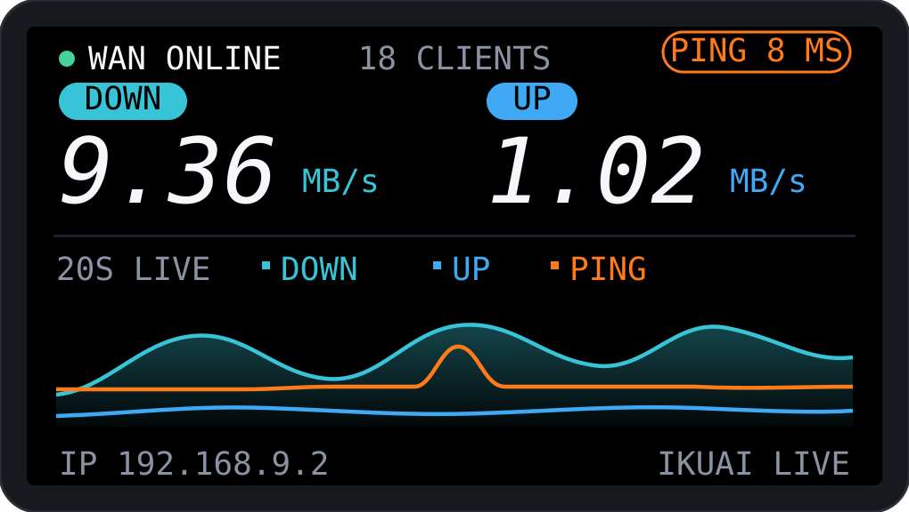
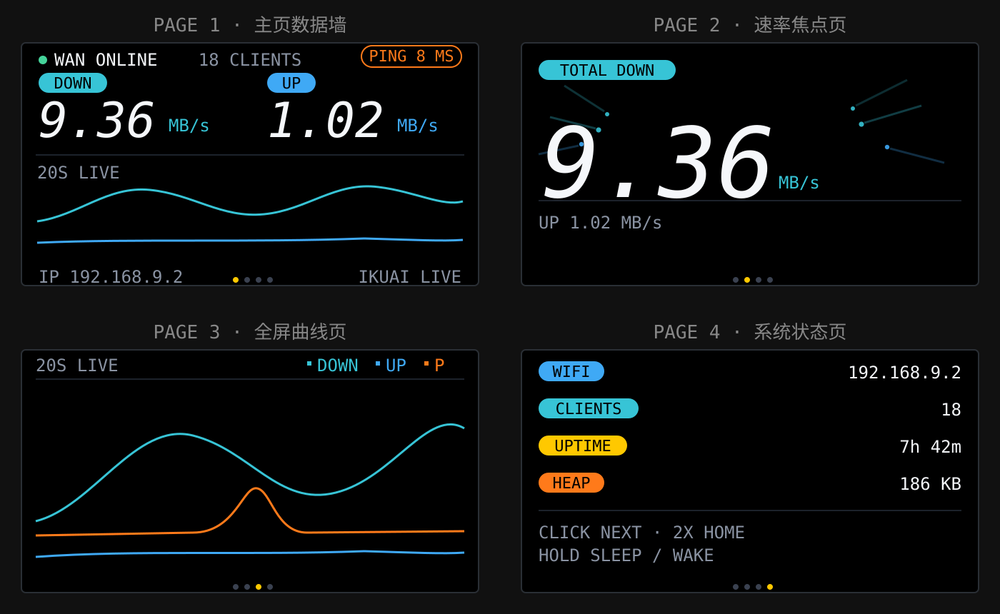
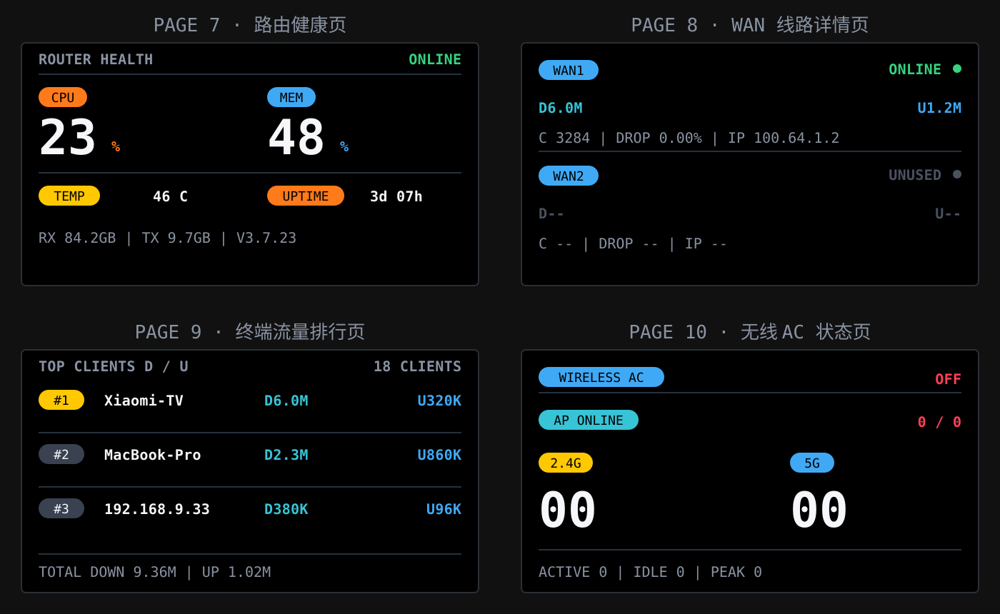
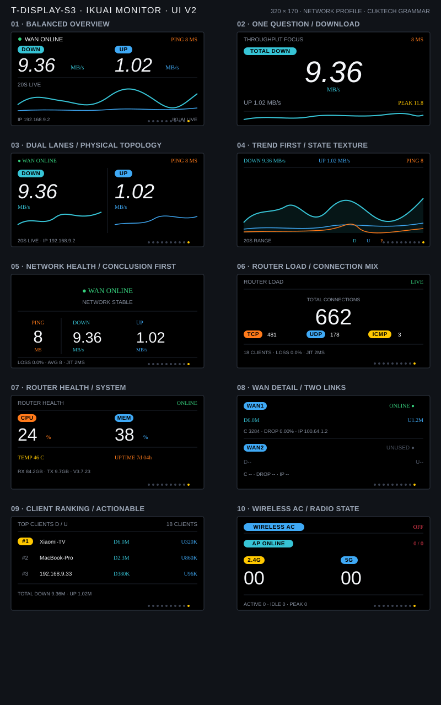

# T-Display-S3 iKuai Network Monitor

This repository contains a focused iKuai router monitor for the LILYGO T-Display-S3. It reads router telemetry over Wi‑Fi and presents WAN status, ping, download/upload rates, clients, and wireless status on the onboard ST7789 display.

The UI is designed as a compact information wall: black background, restrained status colors, large live throughput numbers, and a grid-free rolling trend chart with a nominal 20-second animated window at 15 FPS. The checked-in PlatformIO environment is intentionally pinned to live mode and never substitutes simulated Demo data.

## UI preview

The firmware contains ten single-purpose pages. The SVG previews below show the main screen, pages 1–4, and pages 7–10; the complete ten-page design overview is included separately so the README stays readable on GitHub.









## Features

| Page | Content | Source |
| --- | --- | --- |
| 1 | WAN state, ping, download/upload rates, three-track trend | `monitoring/system`, 1 s |
| 2 | Throughput focus view, upload secondary row, session peak | `monitoring/system` |
| 3 | Dual traffic lanes with independent mini-trends | `monitoring/system` |
| 4 | Full-screen rolling trend and ping | `monitoring/system` + ICMP |
| 5 | Network health conclusion, evidence, and alert guidance | `monitoring/system` + local Wi-Fi |
| 6 | Router load: total/TCP/UDP/ICMP sessions, clients, packet loss, and jitter | `monitoring/system` + ICMP |
| 7 | Router CPU, memory, temperature, uptime, cumulative RX/TX, and firmware | `monitoring/system` |
| 8 | Per-WAN state, live D/U, sessions, dropped packets, and public IP | `monitoring/interfaces-status`, about every 9 s |
| 9 | Top three clients with independent download and upload rates | `monitoring/clients-online`, about every 9 s |
| 10 | Wireless AC state, AP count, band split, active/idle clients, and session peak | AC and wireless endpoints, about every 9 s |

Extended endpoints rotate one request every three seconds to keep router load low, so each of the three source groups refreshes about once every nine seconds. A source is marked `STALE` after 20 seconds without a successful refresh.

The monitor marks each extended data source independently as live or stale instead of presenting old WAN/client/AC values as current. Realtime throughput uses iKuai's instantaneous `stream.download` and `stream.upload` fields directly; cumulative `total_down` and `total_up` are not differenced into a second rate. The UI formats the direct value as `B/s`, `KB/s`, or `MB/s`, and the ping label is `GW` because it measures the local gateway, not an Internet speed test.

The two physical buttons have dedicated directions: BOOT (GPIO0) goes to the previous page and IO14 (GPIO14) goes to the next page. Each action fires after 30 ms debounce with no multi-click or hold delay; the active page dot briefly flashes as feedback. Bidirectional movement caps navigation across the ten pages at five steps. Wi-Fi reconnects with exponential backoff (up to 30 s) instead of hammering the access point. The UI returns home after 60 seconds without input.

Day brightness is configurable from 0–100% and defaults to 45% in the tracked template; SNTP-based night dimming defaults to 12% from 23:00–07:00. The home footer changes to `NIGHT DIM` while the scheduled dim level is active.

## Hardware and display driver

- MCU: ESP32-S3R8, 16 MB Flash, 8 MB OPI PSRAM
- Display: ST7789, landscape 320×170, 8-bit i80 parallel bus
- Peripheral power: GPIO15; pull it high before LCD initialization
- LCD data: GPIO39/40/41/42/45/46/47/48
- LCD control: RST GPIO5, CS GPIO6, DC GPIO7, WR GPIO8, backlight GPIO38
- Previous-page button: BOOT, GPIO0
- Next-page button: IO14, GPIO14

The monitor uses the ESP-IDF `esp_lcd` driver and LVGL 9. The iKuai firmware entry point is `examples/ikuai_widget`; other Arduino/LVGL 8 examples are outside this project's runtime path.

## Build

```bash
cd examples/ikuai_widget
pio run -e t-display-s3
```

The project resolves LVGL 9.2.2 through ESP-IDF Component Manager (`src/idf_component.yml`) and keeps the lock file in `dependencies.lock`. The PlatformIO flags force `APP_DEMO_MODE=0` and `APP_REQUIRE_LIVE_MODE=1`; copy the local configuration files below before expecting a working live connection.

To enable live iKuai monitoring, create local configuration files:

```bash
cp src/config.example.h src/config.h
cp src/ikuai_cert.example.h src/ikuai_cert.h
```

Then:

1. Fill in Wi‑Fi, iKuai host, and Bearer token in `src/config.h`.
2. Keep the PlatformIO live-mode flags enabled.
3. Put the router HTTPS CA certificate in `src/ikuai_cert.h`.
4. Build first, then explicitly run the upload command. Do not commit either local file.

Real credentials, certificates, serial paths, and build outputs are kept out of version control.

## Layout

```text
examples/ikuai_widget/
├── src/main.c                 # Application entry point
├── src/lcd_driver.c           # T-Display-S3 ST7789 i80 driver
├── src/lv_port_disp.c         # LVGL display port
├── src/desktop_widget.c       # Ten-page monitoring UI and motion
├── src/ikuai_monitor.c        # iKuai API, ping, and data cache
├── src/fonts/                 # Pixel-aligned LVGL label and metric fonts
├── src/idf_component.yml      # Pinned LVGL 9.2.2 dependency
├── components/lv_conf.h       # Target-sized LVGL feature configuration
├── docs/                      # UI previews used above
└── platformio.ini             # t-display-s3 build entry
```

## Validation boundary

The current optimized `t-display-s3` image has been built, flashed to a physical board, and exercised on the real iKuai link. USB-JTAG independently verified the bootloader, partition table, and Live application. Runtime evidence includes the 8 MB PSRAM memory test, the 8 KB HTTP response buffer in PSRAM, Wi-Fi association, a successful iKuai HTTPS API response, and a steady second-window `curve_fps=15.0`.

The latest steady-state capture showed 86,879 bytes of internal RAM free, a 31,744-byte largest internal block, and a recovered `curve_fps=15.0`, with no panic, assert, abort, or reboot. Anonymous parser evidence also confirmed three client rows, the current AC-off state, and two WAN status/stream pairs. Final acceptance still requires a direct screen check for startup artifacts, button feedback, rapid page switching, and clipping on the extended pages; flash, serial, and API success are not substitutes for it. Private router credentials and certificates remain local and are not part of this repository.

See [`CHANGELOG.md`](CHANGELOG.md) for the current UI and hardware-validation record.
