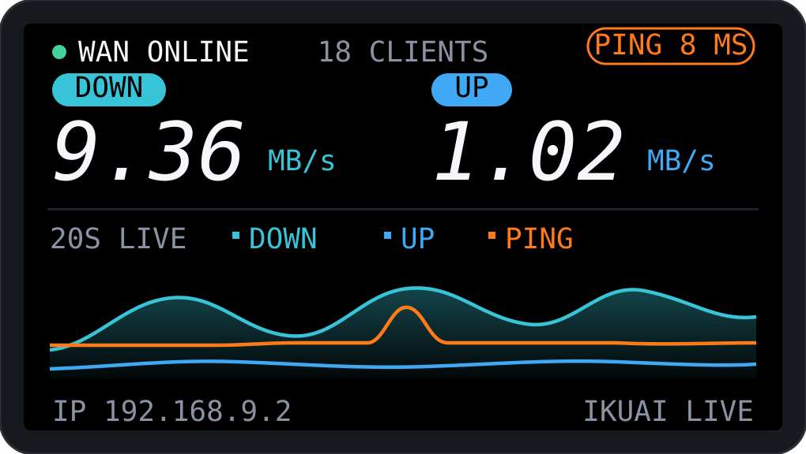
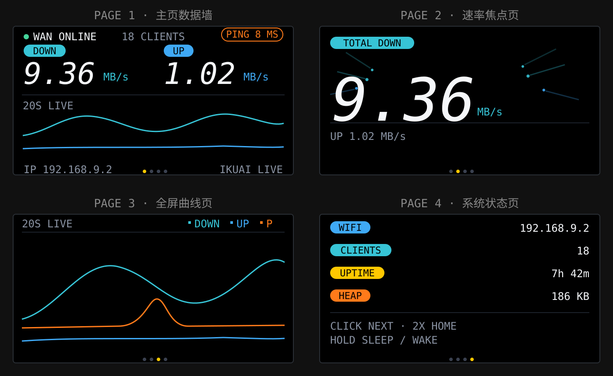
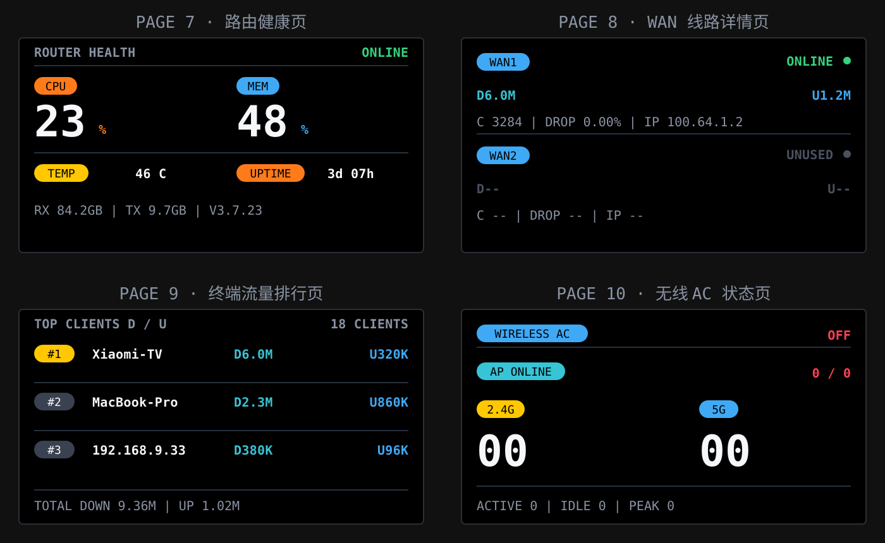
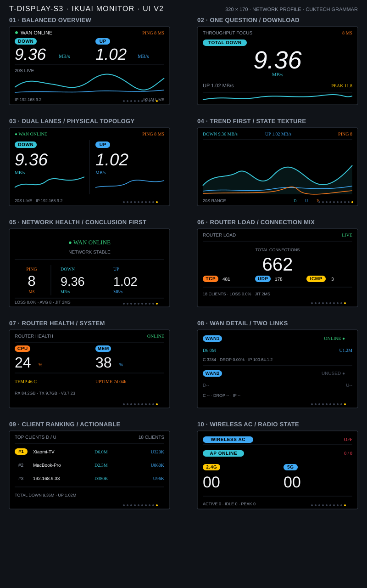

# T-Display-S3 iKuai 网络监控屏

这是一个面向 LILYGO T-Display-S3 的独立小屏监控项目：通过 Wi‑Fi 读取 iKuai 路由器数据，在板载 ST7789 屏幕上显示 WAN 状态、Ping、上下行速率、客户端和无线状态。

项目重点是“拿起来就能读懂”的紧凑信息墙：黑底、少量高饱和状态色、大字号实时速率和无网格趋势曲线。仓库内 PlatformIO 环境固定为实时模式，不会用模拟 Demo 数据替代真实状态。

## UI 预览

固件实际包含十个“一屏一焦点”页面。下面的 SVG 展示主页、第 1–4 页和第 7–10 页；完整十页设计总览单独保留，便于在 GitHub 中查看。









## 功能概览

| 页面 | 内容 | 更新来源 |
| --- | --- | --- |
| 1 | WAN 状态、Ping、上下行速率、三色趋势曲线 | `monitoring/system`，1 秒 |
| 2 | 下行速率焦点页、上行副行、会话峰值 | `monitoring/system` |
| 3 | 上下行双通道与独立微型趋势曲线 | `monitoring/system` |
| 4 | 全屏滚动趋势曲线与 Ping | `monitoring/system` + ICMP |
| 5 | 网络健康结论、证据和告警建议 | `monitoring/system` + 本地 Wi-Fi |
| 6 | 路由负载：总/TCP/UDP/ICMP 连接数、客户端、丢包和抖动 | `monitoring/system` + ICMP |
| 7 | 路由器 CPU、内存、温度、运行时间、累计收发量和版本 | `monitoring/system` |
| 8 | 分 WAN 在线状态、实时上下行、连接数、丢包和公网 IP | `monitoring/interfaces-status`，约 9 秒更新 |
| 9 | 终端流量 Top 3，分别显示下载与上传速率 | `monitoring/clients-online`，约 9 秒更新 |
| 10 | 无线 AC 状态、AP、频段终端、活跃/空闲数和峰值 | AC 和无线统计接口，约 9 秒更新 |

扩展接口采用轮转请求，每 3 秒只请求一组数据，三组数据各自约 9 秒更新一次，减少对路由器的压力；某组连续 20 秒未成功刷新时显示 `STALE`。

扩展数据源现在分别标记为实时或过期：WAN、客户端排行、无线 AC 任一接口失败时不会继续伪装成当前值。实时上下行直接使用 iKuai 的 `stream.download` 和 `stream.upload` 瞬时字段，不再把 `total_down`/`total_up` 累计流量差分成另一套速率，保证与路由器后台的速率口径一致。界面只负责把这个值格式化为 `B/s`、`KB/s` 或 `MB/s`。延迟标签使用 `GW`，明确它测量的是本地网关，不是公网测速。

两个物理按键采用固定方向：BOOT（GPIO0）返回上一页，IO14（GPIO14）进入下一页。按下经 30ms 消抖后立即响应，不再等待双击或区分按压时长；当前页码点会短暂闪亮作为反馈。双向翻页把十页系统的最坏导航成本限制在 5 次。Wi‑Fi 断线后采用指数退避重连，最长间隔 30 秒；60 秒无操作自动回主页。

背光支持 0–100% 配置，仓库模板默认日间 45%；SNTP 授时后 23:00–07:00 默认降到 12%，主页底部会显示 `NIGHT DIM`，便于确认是否是定时降光而不是故障。

## 硬件与显示驱动

- 主控：ESP32-S3R8，16MB Flash，8MB OPI PSRAM
- 屏幕：ST7789，横屏 320×170，8-bit i80 并口
- 外设电源：GPIO15，必须在 LCD 初始化前拉高
- LCD 数据：GPIO39/40/41/42/45/46/47/48
- LCD 控制：RST GPIO5、CS GPIO6、DC GPIO7、WR GPIO8、背光 GPIO38
- 上一页按键：BOOT，GPIO0
- 下一页按键：IO14，GPIO14

此项目使用 ESP-IDF `esp_lcd` 和 LVGL 9；iKuai 固件入口固定为 `examples/ikuai_widget`，其他 Arduino/LVGL 8 示例不属于本项目运行路径。

## 构建

```bash
cd examples/ikuai_widget
pio run -e t-display-s3
```

项目通过 ESP-IDF Component Manager（`src/idf_component.yml`）固定使用 LVGL 9.2.2，并提交 `dependencies.lock` 保证依赖版本稳定。PlatformIO 构建标志固定 `APP_DEMO_MODE=0` 和 `APP_REQUIRE_LIVE_MODE=1`；未创建本地配置时只会显示连接等待或错误状态，不会生成模拟数据：

```bash
pio run -e t-display-s3
```

如果要连接真实 iKuai，再创建本地配置文件：

```bash
cp src/config.example.h src/config.h
cp src/ikuai_cert.example.h src/ikuai_cert.h
```

然后：

1. 在 `src/config.h` 中填写 Wi‑Fi、iKuai 地址和 Bearer Token。
2. 保持 PlatformIO 的实时模式构建标志启用。
3. 在 `src/ikuai_cert.h` 中填写路由器 HTTPS CA 证书。
4. 先完成编译，再明确执行上传命令；两个本地配置文件都不要提交。

真实凭据、证书、串口路径和构建产物不会提交到仓库。

## 目录

```text
examples/ikuai_widget/
├── src/main.c                 # 应用入口
├── src/lcd_driver.c           # T-Display-S3 ST7789 i80 驱动
├── src/lv_port_disp.c         # LVGL 显示适配
├── src/desktop_widget.c       # 10 页监控 UI 与动画
├── src/ikuai_monitor.c        # iKuai API、Ping 与数据缓存
├── src/fonts/                 # 像素对齐的 LVGL 标签与数字字体
├── src/idf_component.yml      # 固定 LVGL 9.2.2 依赖
├── components/lv_conf.h       # 面向本板的 LVGL 功能裁剪配置
├── docs/                      # README 使用的 UI 预览图
└── platformio.ini             # t-display-s3 构建入口
```

## 验证边界

当前优化后的 `t-display-s3` 镜像已完成编译、真实板烧录，并接入真实 iKuai 链路运行。USB-JTAG 分别校验通过 bootloader、分区表和 Live 应用。运行证据包括 8MB PSRAM 测试通过、8KB HTTP 响应缓冲位于 PSRAM、Wi‑Fi 成功关联、iKuai HTTPS API 返回成功，以及第二个完整统计窗口稳定达到 `curve_fps=15.0`。

最新稳态监听显示内部 RAM 剩余 86,879 bytes、最大连续块 31,744 bytes，曲线恢复到 `curve_fps=15.0`，期间没有 panic、assert、abort 或重启。匿名解析证据还确认了 3 条终端排行、当前 AC 关闭状态，以及 2 组 WAN 状态/流量记录。最终仍需直接观察屏幕，检查启动花屏、按键反馈、快速翻页和扩展页裁切；烧录、串口和 API 成功不能替代视觉验收。路由器凭据和证书仍只保留在本地，不会进入仓库。

当前 UI 与硬件验证记录见 [`CHANGELOG.md`](CHANGELOG.md)。
