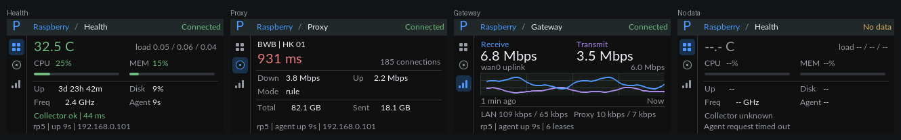

# T-Display-S3 — rp5 网关控制台

320×170 横屏上的树莓派网关监控界面。数据来自 Pi 上的只读聚合代理（`/api/v1/status`，1 Hz），界面分为三页：健康度、代理状态、网关流量。曲线按真实采样时间滚动。



预览直接编译 `src/rp5_view.c` 并用真实 LVGL 渲染，图中是合成数据，未冒充实机照片。字体使用 Lato 12/20px（开源，见 `fonts/`）。

## 三个视图

| 页面 | 内容 |
|---|---|
| Health | 温度、1/5/15 分钟负载、CPU/内存进度条、运行时间、磁盘占用、主频、代理进程运行时长、采集器状态 |
| Proxy | 节点名、实测延迟、连接数、规则模式、mihomo 上下行速率、累计收发 |
| Gateway | `wan0` 收/发速率、最近 60 秒双曲线、LAN 与代理 VLAN 速率 |

GPIO0 上一页、GPIO14 下一页；30 ms 消抖，60 秒无操作回第一页。翻页时新页从侧向滑入并淡入 240 ms（`ease_in_out`，滑移与淡入共用一条动画，不会走偏），保留共享采样历史。右侧页脚显示设备 IP；未拿到数据时页眉显示 `No data` 或 `Check RP5_HOST / RP5_PORT`。

## 数据与显示

- 只有一个 HTTP 数据源：`http://RP5_HOST:RP5_PORT/api/v1/status`，只发 GET，复用一条连接；失败时销毁客户端重建，避免等待旧响应头。
- 配置了 `RP5_TOKEN` 时每个请求带 `Authorization: Bearer <token>`；网关的 rp5-agent 除 `/health` 外都要求鉴权，没有 token 会得到 401。
- `RP5_HOST` 只接受裸地址；带 scheme、路径、空格或端口越界时进入配置错误态并提示，不会静默连不上。`RP5_TOKEN` 只接受 base64url 字符集（`A-Za-z0-9-._~`），防止换行被拼进请求头。
- 每 1 秒采样一次；失败按 2/4/8/16/32 秒退避，成功后回到 1 秒。Wi-Fi 切换会清空快照、曲线与 HTTP 客户端，然后立即重试。
- 快照 10 秒内视为新鲜，否则整页退回 `--`，不会把上次的数字当成实时值继续画。
- 速率：代理给字节/秒，界面显示十进制 kbps / Mbps / Gbps。零值显示 `0`，缺失显示 `--`。
- 曲线保留 128 个点，横轴按真实时间戳定位，超过 10 秒的断采断开连线；窗口 60 秒，1 秒一个点、约 4.6 px/s 左移。绘图区是 272 px 的光栅，1 px 约 220 ms，所以曲线只在滚动量、纵轴或最新采样真的变化时重绘，而不是每帧重画。
- 纵轴按窗口内峰值取 1-2-5 台阶（每格都是整数台阶，最低 1 Mbps 顶）：出现新峰值立即放大，绝不裁顶；缩小走 4 步 ×100 ms 楼梯，且要再被一次采样确认才执行，避免在两个台阶之间抖动。
- 数值与进度条共用同一个 Q16 定点指数趋近（τ=150 ms，α 按真实帧距查 1 ms 分辨率的表，覆盖到 128 ms），所以数字和条永远读同一个值，收敛时间与帧率无关；变化小于半个显示最小位就死区忽略，小于 0.5 位直接落位。空数据是状态不是数值：先变 `--`、条收回到 0，重新有数时直接落位而不是一路滚过来。
- 温度取 SoC `thermal_thermal_zone0`；阈值 70/80 °C 变色，CPU 70/90%，内存 75/90%，延迟 300/800 ms。负温度正常显示（旧版用负数当"无数据"哨兵，会把 -12.5 °C 吞成 `--`）。
- 图表网格线、收/发两条曲线、页签选中图标都做了亮度分离（网格对面板 ≥3:1，两序列不再只有色相差），低背光和灰度下仍可分辨。
- 保留既有机制：Wi-Fi 重试、首帧完成后亮屏、UI 任务栈放在 PSRAM。夜间降背光按 16 级背光逐级下降（每 100 ms 一级，最多 1.6 s），不再是 23:00 的一次硬跳；调亮仍是瞬时的，因为该控制器升一级要走 15 个脉冲。
- UI 任务按 16 ms 刷新，`CONFIG_FREERTOS_HZ=1000`：默认 100 Hz 的 tick 会把 `pdMS_TO_TICKS(16)` 量化成 1 个 tick（10 ms），帧距在 10/20 ms 之间交替，动效时钟跟着抖。
- 实机测得稳定态只有约 11–14 fps（帧距 72–91 ms），瓶颈是软件渲染而不是并口：`sdkconfig` 里 CPU 停在 160 MHz（板卡定义 240 MHz，工程未显式设置，属继承来的默认值）。动效查表因此覆盖到 128 ms；提到 240 MHz 能把帧距压回约 50–60 ms、动效更顺，代价是这台 7×24 桌面设备的发热与功耗，需实测后再定。
- 心跳日志区分两个口径：`fps` 是 LVGL 真正渲染的帧数，`i80_tx` 是并口 DMA 传输次数（局刷一个脏区一次），两者不相等。

## 配置

```bash
test -f src/config.h || cp src/config.example.h src/config.h
```

填写 `APP_WIFI_SSID`、`APP_WIFI_PASS`、`RP5_HOST`、`RP5_PORT`、`RP5_TOKEN`；可同时调整时区、日/夜背光与 `APP_BL_PCT`。`src/config.h` 已被 Git 忽略。

`RP5_TOKEN` 必须与网关 `/etc/mihomo/secrets/rp5-agent.token` 一致（`secrets.token_urlsafe(32)`，43 字符）；留空等于不发送 Authorization（旧网关）。网关做整机回滚时会重新生成该 token，回滚后要把新值写回这里并重新烧录。固件强制真实数据模式（`APP_DEMO_MODE=0`），没有配置也不会生成演示数据。

## 构建与验证

```bash
# 在本目录
pio run -e t-display-s3
pio run -e t-display-s3 -t upload --upload-port /dev/cu.usbmodemXXXX
pio device monitor -b 115200
```

```bash
# 在仓库根目录
python3 tests/test_rp5_status_parser.py   # 解析器 + 真实响应样本
python3 tests/test_rp5_scheduler.py       # 节拍、退避、网络切换
python3 tests/render_rp5_ui.py            # 真实 LVGL 渲染 + 布局/空数据断言
```

渲染产物的原始 PPM 与 PNG 位于 `/tmp/rp5-console-render`。构建与主机测试不替代屏幕颜色、亮度和实体按键的实机确认。

## 硬件

- **主控**：ESP32-S3R8（16MB Flash，8MB OPI PSRAM）
- **屏幕**：ST7789，170×320，**8-bit 并口（i80，非 SPI）**
- **按键**：BOOT（GPIO0）上一页；IO14（GPIO14）下一页

## ⚠ 重点注意事项（移植/烧录前必读）

1. **GPIO15 是外设总电源**：必须在初始化最前面置高，否则 LCD、背光全部不工作。已在 `lcd_init()` 首步处理。
2. **屏幕是并口不是 SPI**：D0-D7 = GPIO 39/40/41/42/45/46/47/48，WR=8、DC=7、CS=6、RST=5、BL=38。驱动基于 `esp_lcd` i80，与 SPI 驱动不通用。
3. **sdkconfig 必须匹配**：Flash 16MB QIO 80MHz、PSRAM **OPI** 80MHz；`sdkconfig.defaults` 首次构建自动生效。
4. **使用 ESP-IDF 构建环境**：不要套用 Arduino USB CDC 宏；外部供电黑屏时先核对供电、复位日志和夜间背光。
5. **烧录失败时手动进下载模式**：按住 BOOT → 按一下 RST → 松开 RST → 松开 BOOT，再重新 upload。
6. **分辨率**：横屏 320×170，页脚紧贴下边缘（y=154，页区到 168），加内容前先算高度。
7. **Lato 缺字形**：没有 `°` 与 `·`，界面对应位置用 `32.5 C`、`|` 代替；改文案时不要引入缺字形字符。

## 代码结构

- `desktop_widget.c`：Wi-Fi、授时、背光、按键与 UI 任务生命周期。
- `rp5_view.c/h`：三页界面；主机渲染测试直接编译同一份代码。
- `rp5_monitor.c/h`：HTTP、JSON 解析、快照与曲线、退避调度。
- `lcd_driver.c/h`、`lv_port_disp.c/h`：ST7789 i80 与 LVGL 显示移植。
- `fonts/`：Lato 12/20px 字体及许可证。

首次配置、接口字段与时效规则见[主 README](../../README.md)。
